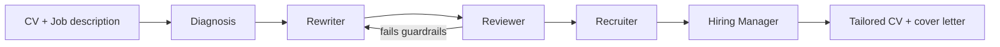

<!-- Banner -->


<p align="center">
  <a href="https://git.io/typing-svg"></a>
</p>

<p align="center">
  
  <a href="mailto:deepakkatukuri@gmail.com"></a>
  <a href="https://github.com/Deepak589?tab=repositories"></a>
  
</p>

---

## 👨‍💻 About me
```python
class Deepak:
    role      = "MSc Data Science student, ex-software engineer"
    base      = "Berlin, Germany"
    focus     = ["RAG", "Agentic AI", "LLM evaluation", "ML applications"]
    learns_by = "building, not binge-watching"
    now       = "FilingCheck: claim verification against SEC filings"
    goal      = "AI Engineer"
```

## 🛠️ Tech stack
<p>
  
</p>

<details open>
<summary><b>🧠 AI / LLM engineering</b></summary>

`RAG` · `Hybrid search (dense + sparse + ColBERT)` · `RRF` · `BGE-M3` · `pgvector (HNSW)` · `Chunking: recursive / semantic / parent-child / late` · `RAGAS` · `Langfuse` · `LangChain` · `LangGraph` · `LCEL` · `MCP servers` · `Claude API` · `Ollama / MLX local inference` · `SFT / LoRA / DPO concepts`
</details>

<details>
<summary><b>⚙️ Backend & infra</b></summary>

`FastAPI` · `PostgreSQL` · `JWT auth` · `Docker` · `CI/CD` · `Render` · `Neon` · `Vercel`
</details>

<details>
<summary><b>🎨 Frontend & data</b></summary>

`React` · `Vite` · `Tailwind` · `Next.js` · `Pandas` · `Data visualization`
</details>

## 🚀 Featured projects

<table>
<tr>
<td width="50%" valign="top">

### 🔎 [RAG_pipeline](https://github.com/Deepak589/RAG_pipeline)
Framework-free RAG in ~270 lines of Python. Hybrid retrieval with RRF, HNSW indexing, evaluated with Hit Rate@k, Recall@k, MRR and RAGAS.

  

</td>
<td width="50%" valign="top">

### 🤖 [Job_hunt_Agentic_AI](https://github.com/Deepak589/Job_hunt_Agentic_AI)
5-agent LangGraph pipeline (Diagnosis → Rewriter → Reviewer → Recruiter → Hiring Manager) that tailors CVs and cover letters with guardrails and a no-fabrication rule.

  

</td>
</tr>
<tr>
<td width="50%" valign="top">

### 🥗 [RA_project](https://github.com/Deepak589/RA_project) · [docs](https://github.com/Deepak589/RA_Nutrition_app)
Full-stack nutrition app with JWT auth, deployed on Render + Vercel + Neon. ML tier planned.

  

</td>
<td width="50%" valign="top">

### 🌐 [NextJs-Portfolio](https://github.com/Deepak589/NextJs-Portfolio)
Personal portfolio site built with Next.js.

 

</td>
</tr>
</table>

<sub>Also: [ML_Final_project](https://github.com/Deepak589/ML_Final_project) · [DV_Final_project](https://github.com/Deepak589/DV_Final_project) · [ML-projects](https://github.com/Deepak589/ML-projects)</sub>

## 🗺️ How my agent pipeline works


## 📊 GitHub stats
<p align="center">
  
  
</p>
<p align="center">
  
</p>

## 🐍 Contribution snake
<p align="center">
  
</p>

## 🎯 Currently
- 🔭 Building **FilingCheck**, an evidence-grounded claim verifier for SEC filings (agentic RAG)
- 📈 Improving retrieval quality and evaluation on my RAG pipeline
- 💼 Looking for **AI Engineer** roles in Berlin / remote


